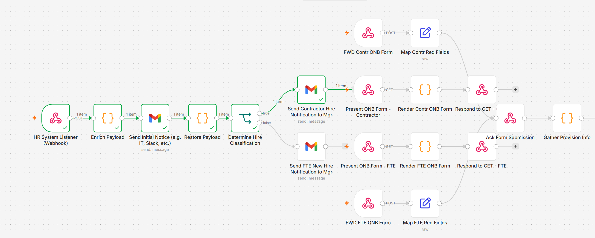
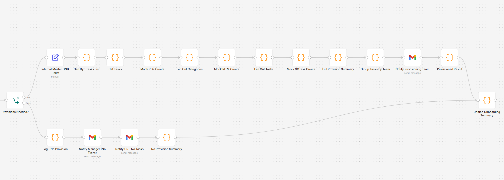
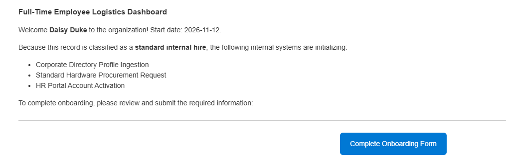
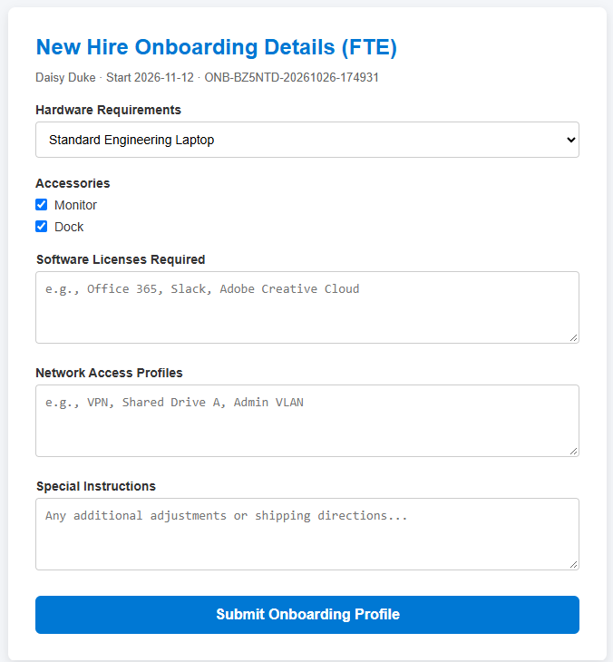
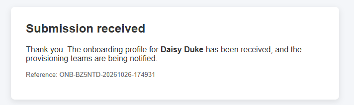
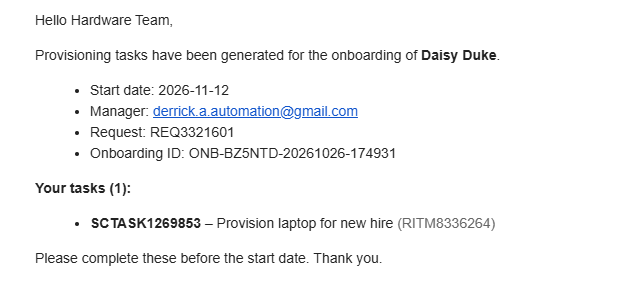
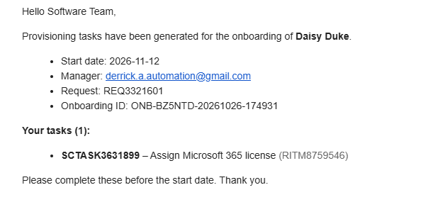
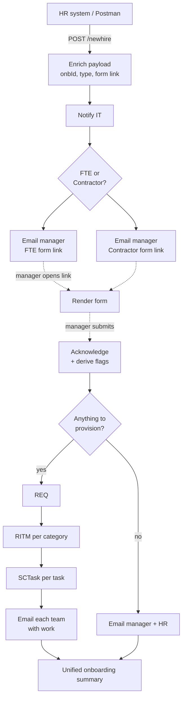

# n8n Onboarding Automation

An HR-triggered employee onboarding workflow built in [n8n](https://n8n.io). A new-hire record from HR starts the process, the hiring manager supplies hardware, software and access needs through a web form, and the workflow turns those answers into a ServiceNow-style request: one **REQ** per hire, one **RITM** per fulfilment category and one **SCTask** per unit of work. Each fulfilment team is notified only about its own tasks, and every run ends in a single audit record.

ServiceNow is currently mocked. The three create steps are isolated nodes with a fixed output shape, so they can be swapped for real API calls without touching the rest of the flow (see [docs/roadmap.md](docs/roadmap.md)).

**Intake:** HR trigger, manager notification and intake forms



**Provisioning:** REQ, RITMs and SCTasks, team routing and the final summary



| 1. Manager is emailed | 2. Manager completes the form |
|---|---|
|  |  |
| **3. Manager gets instant confirmation** | **4. Each team gets only its own tasks** |
|  | <br> |

## How it works



The workflow runs as three separate executions, one per webhook:

| Stage | Webhook | What happens |
|---|---|---|
| 1. HR trigger | `POST /newhire` | Generates the onboarding ID, normalizes the employment type, emails the manager a pre-filled form link |
| 2. Form display | `GET /fte-onboarding-form`, `GET /contr-onboarding-form` | Renders the provisioning form, carrying the hire record as hidden fields |
| 3. Form submit | `POST /fte-onboarding-submit`, `POST /contr-onboarding-submit` | Acknowledges the manager immediately, then builds REQ, RITMs and SCTasks, notifies teams and writes the summary |

Routing from category to team:

| Category | Task types | Team |
|---|---|---|
| Hardware | Laptop, Monitor, Dock | hardware |
| Software | Microsoft 365, Slack, Adobe | software |
| Access | VPN, Shared Drive A, Admin VLAN | network |
| Special | Free-text special instructions | facilities |

## Repository layout

```
workflows/onboard-automation.json        n8n workflow (sanitized export)
postman/onboarding.postman_collection.json  test requests for every path
tests/simulate.js                        offline simulator, runs the workflow logic without n8n
tests/fixtures/                          sample HR payloads
scripts/sanitize_export.py               prepares an n8n export for commit
docs/data-contract.md                    every field, where it comes from, where it goes
docs/roadmap.md                          ServiceNow integration plan and open items
CHANGELOG.md
```

## Running it

1. In n8n, **Workflows → Import from File** and choose `workflows/onboard-automation.json`.
2. Open any Gmail node and select your Gmail credential (credential IDs are stripped from the export).
3. Set the notification addresses. They are Gmail plus-addresses on one test inbox, defined in the **Send Initial Notice**, **Group Tasks by Team** and **Notify HR - No Tasks** nodes.
4. If n8n isn't at `http://localhost:5678`, change `BASE_URL` at the top of the **Enrich Payload** node. It's the only place the host is set.
5. Publish/activate the workflow. The form links in the manager email point to production `/webhook/` URLs, so the workflow must be active for them to work. Deactivate any older version first, since two active workflows can't share webhook paths.

## Testing

**Offline**, no n8n required (Node.js 18+):

```bash
node tests/simulate.js
```

It executes every Code node's real JavaScript, emulates the Webhook, Set, IF, Gmail and Respond nodes, and follows the workflow's connections through the FTE, Contractor, no-provision and malformed-link paths, then checks the results (task counts, routing, emails without blank fields, HTML escaping, round-tripping of names like O'Neil).

**Live**, against n8n: import `postman/onboarding.postman_collection.json`, set the `managerEmail` collection variable to an inbox you can read, and run the requests. Folder 1 covers the HR trigger, including the edge cases; folder 2 posts straight to the form-submit webhooks so the provisioning half can be tested without clicking through email.

Example HR payload (leave out `onbId`; the workflow generates it):

```json
{
  "firstName": "Mary-Kate",
  "lastName": "O'Neil",
  "employmentType": "FTE",
  "startDate": "2026-11-03",
  "managerEmail": "your.inbox+mgr@gmail.com",
  "employeeEmail": "mk.oneil@example.com"
}
```

## Committing changes from n8n

Edit in n8n, export with **Download**, then:

```bash
python3 scripts/sanitize_export.py ~/Downloads/Onboard-Automation-v3.json
node tests/simulate.js
git add workflows/ && git commit -m "Describe the change"
```

The sanitizer removes instance metadata, placeholders credential IDs, sets `active: false`, sorts nodes and keys so diffs stay readable, and warns if anything looks like a secret. For a public repository, add `--redact-email your.inbox@gmail.com=automation.inbox@example.com` to swap the test inbox (and its +tags) for a placeholder.

## Status

Proof of concept, running end to end with mocked ServiceNow. Next: ServiceNow Table API integration on a developer instance. See [docs/roadmap.md](docs/roadmap.md).
